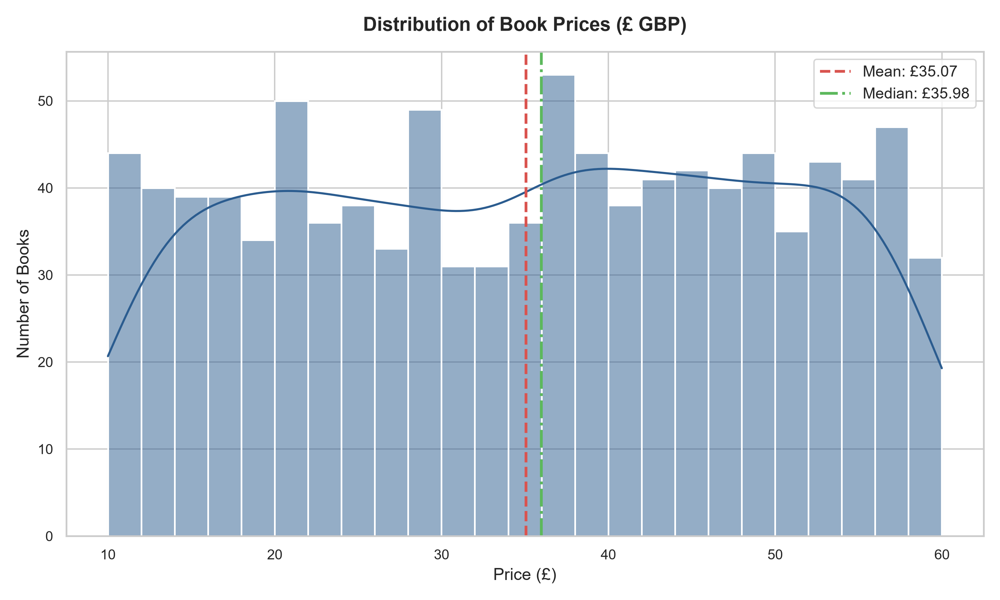
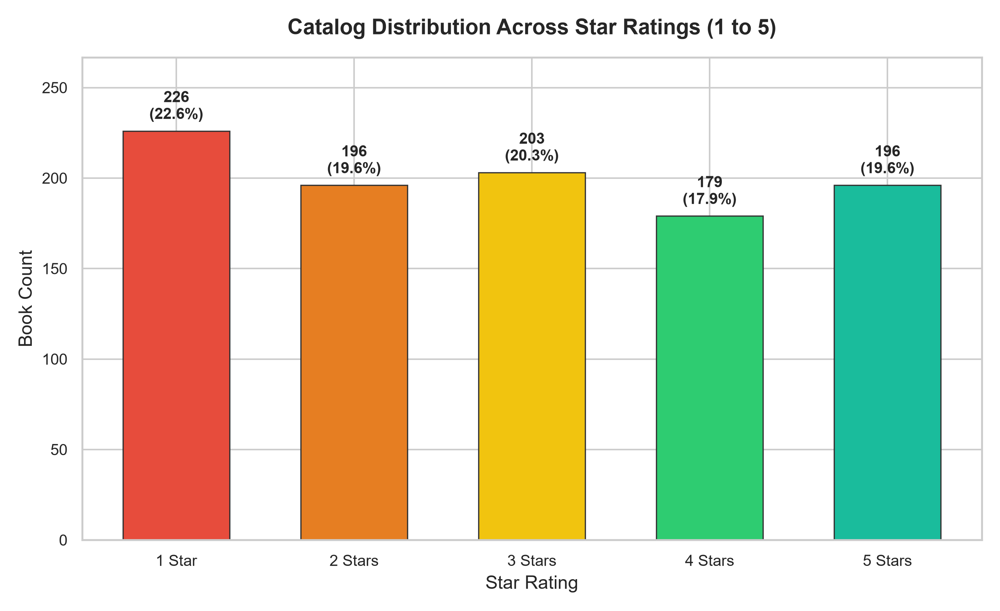
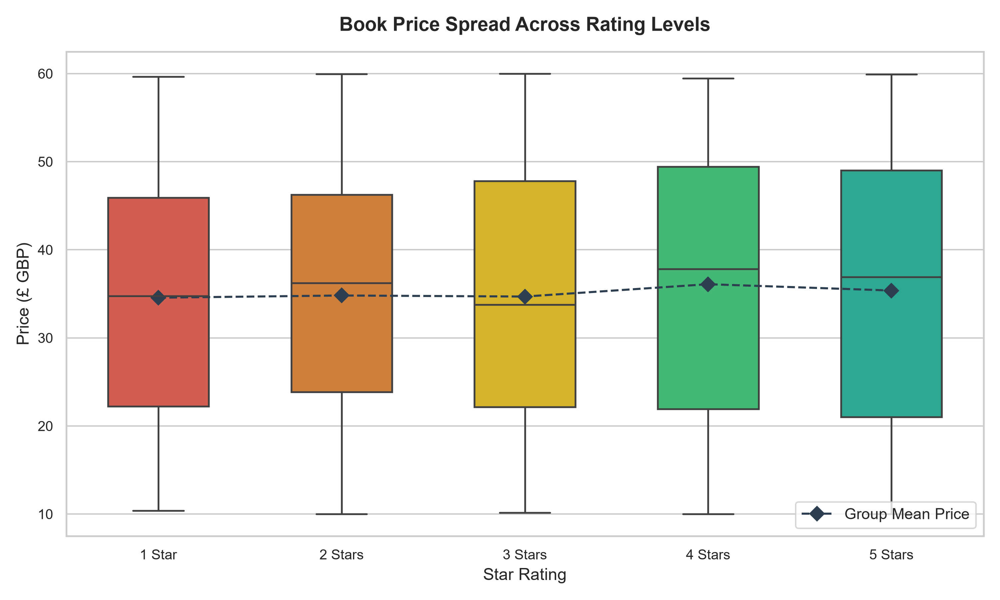
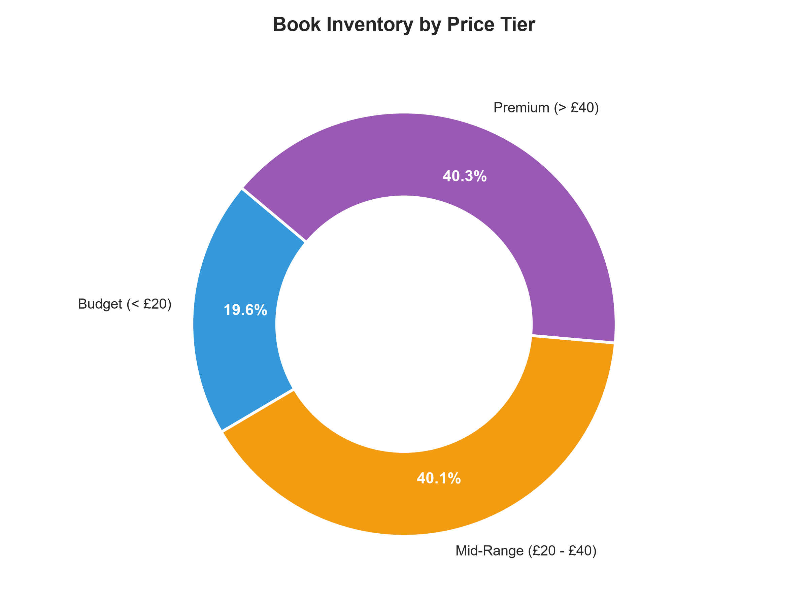
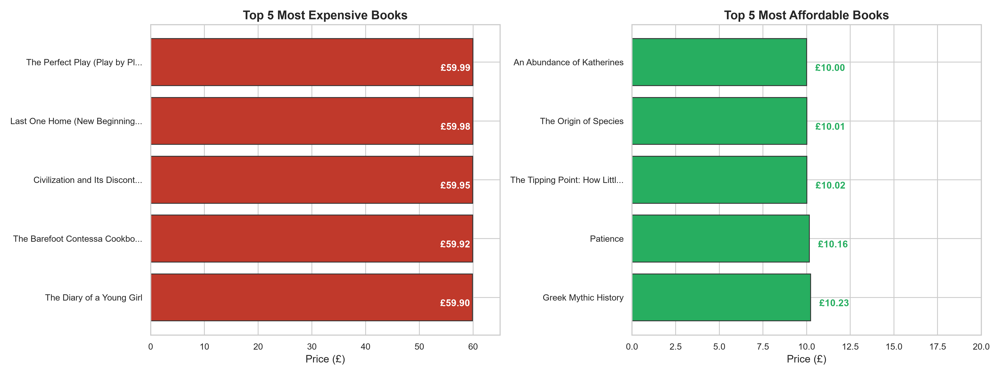

# 📚 Books Data Analysis & Exploratory Insights

[](https://www.python.org/)
[](https://pandas.pydata.org/)
[](https://seaborn.pydata.org/)
[](https://matplotlib.org/)
[](https://github.com/ranjithbrs/books-data-analysis/actions/workflows/ci.yml)
[](LICENSE)

> 🌟 **Turning messy bookstore data into colorful charts and clear business insights anyone can understand in 10 seconds!**

An end-to-end **Exploratory Data Analysis (EDA)** and data cleaning project analyzing **1,000 book records** systematically extracted from [Books to Scrape](https://books.toscrape.com/) via the companion web scraping pipeline [ooks-web-scraping](https://github.com/ranjithbrs/books-web-scraping).

This project cleans messy web-scraped data, audits data hygiene (missing values & duplicate titles), engineers analytical attributes, validates pricing models, and delivers actionable e-commerce business recommendations.

> 📄 **Looking for the executive summary?** Read the full [**Executive Project Report (REPORT.md)**](REPORT.md).

---

## 💡 What is this Project in 30 Seconds? (In Plain English)

Imagine you run an online bookstore with 1,000 books. You have a big spreadsheet with titles, prices, ratings, and stock numbers, but looking at thousands of rows of numbers is confusing.

**This project turns that raw data into clear, visual business answers**:
- 💰 **Do expensive books get better ratings?** (No! Our analysis shows a very weak observed linear association between price and rating, r = 0.028).
- 🏷️ **What do most books cost?** Most books are priced evenly between £10 and £60, with the average book costing **£35.07**.
- 📊 **Visual Charts:** Generates clean bar charts, histograms, and scatter plots that a business manager or store owner can immediately understand without reading code.

---

## 📑 Table of Contents
- [What is this Project?](#-what-is-this-project-in-30-seconds-in-plain-english)
- [Project Architecture](#-project-architecture)
- [Key Analytical Findings](#-key-analytical-findings)
- [Data Quality & Hygiene Audit](#-data-quality--hygiene-audit)
- [Visual Insights](#-visual-insights)
- [Data Pipeline & Schema](#-data-pipeline--schema)
- [Strategic Business Recommendations](#-strategic-business-recommendations)
- [Repository Structure](#-repository-structure)
- [Quickstart: How to Run Locally](#-quickstart-how-to-run-locally)
- [Documented Notebook Execution Steps](#-documented-notebook-execution-steps)
- [Key Engineering & Analytical Takeaways](#-key-engineering--analytical-takeaways)
- [Author & Connect](#-author--connect)
- [License](#-license)

---

## 📐 Project Architecture

```
Raw Web Data (1,000 Rows x 4 Cols)
   [books_all_pages.csv]
           │
           ▼
 Automated Validation Suite (src/validate_data.py)
   ├── Dimension check: exactly 1,000 records across 50 catalog pages
   ├── Null value audit: 0 missing cells (100% complete)
   └── Duplication check: 0 exact duplicate rows, 1 repeated title with distinct prices
           │
           ▼
 Data Cleaning Pipeline (src/clean_data.py)
   ├── 1. Title Encoding Repair (UTF-8 / Latin-1 Mojibake fix)
   ├── 2. Regex Numeric Price Extraction (£51.77 -> 51.77 float)
   ├── 3. Ordinal Rating Mapping ("One".."Five" -> 1..5 int)
   └── 4. Feature Engineering (Price Tiers, Title Length & Words)
           │
           ▼
 Cleaned Analytical Dataset (data/processed/books_cleaned.csv)
           │
     ┌─────┴────────────────────────┐
     ▼                              ▼
Jupyter EDA Notebook         Publication Figures
(notebooks/exploratory_      (figures/*.png & src/generate_charts.py)
 data_analysis.ipynb)
```

---

## 💡 Key Analytical Findings

| Metric / Question | Finding | Analytical & Commercial Takeaway |
| :--- | :--- | :--- |
| **Catalog Price Range** | **£10.00 – £59.99** | Continuous uniform price distribution with zero outliers. |
| **Average & Median Price** | **Mean: £35.07** \| **Median: £35.98** | Highly symmetrical distribution (Mean $\approx$ Median). |
| **Price vs. Rating Correlation** | **Pearson $r = 0.028$ (Very Weak)** | **Observation:** Weak observed linear association; higher customer ratings do not correspond to higher retail prices in this catalog. |
| **Market Segment Breakdown** | Premium: **40.3%** \| Mid-Range: **40.1%** \| Budget: **19.6%** | Over 80% of books fall into mid and premium price brackets (£20–£60). |
| **Rating Balance** | 1★ (22.6%), 2★ (19.6%), 3★ (20.3%), 4★ (17.9%), 5★ (19.6%) | Balanced rating distribution across all 5 tiers (~18% to 23% per tier). |
| **Most Expensive Title** | *The Perfect Play (Play by Play #1)* — **£59.99** (Rated 3★) | Premium-priced title with average satisfaction. |
| **Most Affordable Title** | *An Abundance of Katherines* — **£10.00** (Rated 5★) | Top-rated book available at lowest price point (ideal acquisition driver). |

---

## 🔍 Data Quality & Hygiene Audit

### 1. Missing Value Analysis
- Programmatic inspection reveals **zero missing values** across both raw and processed datasets.
- Every book entry possesses a complete title, price string, rating class, and availability status.

### 2. Duplicate Record Handling
- **Exact Row Duplicates:** **0 rows**. No rows have identical values across all 4 attributes.
- **Title-Level Duplicate Audit:** Exactly **1 title** appears twice in the catalog:
  - *Title:* `"The Star-Touched Queen"`
  - *Listing 1 (Row 236):* Price = **£46.02**, Rating = **Five**, Status = **In stock**
  - *Listing 2 (Row 358):* Price = **£32.30**, Rating = **Five**, Status = **In stock**
  - *Resolution:* Both records are retained. They represent two distinct catalog listings with different prices on the source platform, without asserting why.

### 3. Price Conversion & Validation
- Prices extracted using regular expression `r'(\d+\.\d+)'` to strip non-ASCII artifacts (`£`) and isolate decimal amounts as `float64`.
- Bounded strictly between **£10.00** (min) and **£59.99** (max) with a standard deviation of **£14.45**.

### 4. Mutually Exclusive & Collectively Exhaustive (MECE) Segmentation
- **Budget (< £20):** `[£0.00, £20.00)` — **196 titles (19.6%)**
- **Mid-Range (£20 - £40):** `[£20.00, £40.00)` — **401 titles (40.1%)**
- **Premium (> £40):** `[£40.00, ∞)` — **403 titles (40.3%)**
- Total: Exactly **1,000 titles (100.0%)** with zero unclassified or overlapping records.

---

## 📊 Visual Insights

### 1. Catalog Price Distribution
Prices span smoothly between £10 and £60 with an average price of **£35.07**.


### 2. Rating Breakdown Across Tiers
The catalog displays a balanced rating distribution across all five tiers (~18% to 23% per tier).


### 3. Price Spread Grouped by Star Rating (Box Plot)
Box-and-whisker distributions demonstrate that quartile spreads and median prices are virtually identical across all star levels ($r = 0.028$).


### 4. Consumer Retail Price Tiers
Segmented into Budget (< £20), Mid-Range (£20 - £40), and Premium (> £40).


### 5. Top 5 Most Expensive vs. Top 5 Most Affordable Books
A side-by-side comparison of the catalog extremes.


---

## 📈 Strategic Business Recommendations

1. **De-Link Rating from Pricing Power:**  
   Because customer star rating has a very weak observed linear association with price ($r = 0.028$), retail merchandising teams should not assume higher-priced books provide higher satisfaction. Search rankings and recommendation algorithms should evaluate quality metrics separately from price.
2. **Promote Gateway Loss-Leader Titles:**  
   High-satisfaction, low-cost titles like *An Abundance of Katherines* (£10.00, 5★) and *Greek Mythic History* (£10.23, 5★) should be positioned prominently on landing pages and introductory email campaigns to drive customer acquisition.
3. **Dynamic Value-Based Re-pricing:**  
   Books carrying premium prices (> £55) with low customer satisfaction (e.g. *Civilization and Its Discontents*, £59.95, 2★) face slow inventory turnover. Markdowns of 15–20% can accelerate liquidation without eroding brand equity.
4. **Assortment Gap in Entry-Level Segment:**  
   Over 80% of inventory sits above £20. Sourcing additional titles in the £5–£15 range will capture price-sensitive impulse buyers and expand the top of the retail funnel.

---

## 🗃️ Data Pipeline & Schema

### Cleaned Dataset Schema (`data/processed/books_cleaned.csv`)

| Column Name | Data Type | Description | Example |
| :--- | :--- | :--- | :--- |
| `title` | `string` | Full book title with repaired encoding | *A Light in the Attic* |
| `price_gbp` | `float64` | Numeric book price in British Pounds (£) | `51.77` |
| `rating_numeric` | `int64` | Ordinal star rating (1 to 5) | `3` |
| `rating_text` | `string` | Original textual rating | `Three` |
| `in_stock` | `bool` | In-stock inventory indicator | `True` |
| `title_length` | `int64` | Character count of the cleaned title | `20` |
| `title_word_count` | `int64` | Word count of the title | `5` |
| `price_tier` | `category` | Retail tier (`Budget`, `Mid-Range`, `Premium`) | `Premium (> £40)` |

---

## 📁 Repository Structure

```text
books-data-analysis/
├── data/
│   ├── raw/
│   │   └── books_all_pages.csv           # Original 1,000-row scraped dataset
│   └── processed/
│       └── books_cleaned.csv             # Cleaned analytical dataset (1,000 x 8)
├── figures/                              # High-resolution exported figures (300 DPI)
│   ├── 01_price_distribution.png
│   ├── 02_rating_distribution.png
│   ├── 03_price_by_rating_boxplot.png
│   ├── 04_price_tiers_breakdown.png
│   └── 05_top_cheapest_and_expensive.png
├── notebooks/
│   └── exploratory_data_analysis.ipynb    # Fully executed Jupyter Notebook with embedded plots & tables
├── src/
│   ├── clean_data.py                     # Data cleaning & feature engineering pipeline
│   ├── generate_charts.py                # Visual figure generation script (300 DPI)
│   └── validate_data.py                  # Automated data quality & schema verification suite
├── analysis.py                           # Quick terminal summary statistics runner
├── REPORT.md                             # Comprehensive Executive Project Report
├── requirements.txt                      # Project Python dependencies (UTF-8 encoded)
├── .gitignore                            # Virtual environment & cache ignore rules
├── LICENSE                               # MIT License
└── README.md                             # Project documentation & visual report
```

---

## 🚀 Quickstart: How to Run Locally

### 1. Clone the Repository
```bash
git clone https://github.com/ranjithbrs/books-data-analysis.git
cd books-data-analysis
```

### 2. Set Up Virtual Environment & Dependencies
```bash
# Create and activate virtual environment
python -m venv .venv

# On Windows (PowerShell):
.venv\Scripts\Activate.ps1

# On macOS/Linux:
source .venv/bin/activate

# Install required packages
pip install -r requirements.txt
```

### 3. Run the Data Pipeline & Validation Suite
```bash
# Step 1: Execute automated data quality & schema validation suite
python src/validate_data.py

# Step 2: Clean raw data and engineer features
python src/clean_data.py

# Step 3: Generate all 5 publication-ready visual figures
python src/generate_charts.py

# Step 4: Run executive terminal summary report
python analysis.py
```

---

## 📓 Documented Notebook Execution Steps

The notebook located at [`notebooks/exploratory_data_analysis.ipynb`](notebooks/exploratory_data_analysis.ipynb) comes **pre-executed with all outputs, statistical tables, and high-resolution charts embedded** directly for GitHub viewing.

If you wish to execute the notebook interactively:

### Option A: Using VS Code (Recommended)
1. Open the project folder in VS Code: `code .`
2. Open `notebooks/exploratory_data_analysis.ipynb`.
3. In the top-right corner of the editor, click **Select Kernel**.
4. Choose **Python Environments...** and select `.venv (Python 3.x)`.
5. Click **Run All** at the top of the notebook.

### Option B: Using JupyterLab / Classic Notebook
1. Install Jupyter in your virtual environment:
   ```bash
   pip install jupyterlab
   ```
2. Launch JupyterLab from the project root:
   ```bash
   jupyter lab
   ```
3. Navigate to `notebooks/` and open `exploratory_data_analysis.ipynb`.
4. In the menu, click **Kernel** $\rightarrow$ **Restart Kernel and Run All Cells...**.

### Cell Output Verification Table
| Cell Range | Stage | Expected Output |
| :--- | :--- | :--- |
| **Cells 1–3** | Setup & Raw Loading | Confirmation: 1,000 rows, 4 columns loaded. |
| **Cells 4–5** | Data Quality Audit | 0 nulls, 0 exact duplicate rows, 1 duplicate title documented. |
| **Cells 6–8** | Cleaning & Feature Engineering | Cleaned preview table and price tier counts. |
| **Cells 9–10** | Price Distribution (Histogram) | Chart: `01_price_distribution.png` (Mean £35.07). |
| **Cells 11–12** | Rating Distribution (Bar Chart) | Chart: `02_rating_distribution.png` (Uniform ~20%). |
| **Cells 13–15** | Price by Rating (Box Plot) | Chart: `03_price_by_rating_boxplot.png` ($r = 0.028$). |
| **Cells 16–17** | Market Segmentation (Donut Chart) | Chart: `04_price_tiers_breakdown.png`. |
| **Cells 18–19** | Catalog Extremes (Horizontal Bars) | Chart: `05_top_cheapest_and_expensive.png`. |
| **Cells 20–24** | Strategic Conclusions | Written executive takeaways and business decisions. |

---

## 💡 Key Engineering & Analytical Takeaways

1. **Defensive Encoding Normalization**: Web-scraped content frequently mixes byte interpretations (e.g. UTF-8 multi-byte characters like smart quotes `’` misread as Windows-1252 `’`). Handled gracefully through bidirectional byte decoding (`latin1` $\rightarrow$ `utf-8`).
2. **Robust Currency Parsing**: Extracted clean floating-point numbers via regular expressions (`r'(\d+\.\d+)'`), insulating the pipeline from currency symbol rendering quirks.
3. **Weak Observed Linear Association**: Observed a very weak linear association between price and rating ($r = 0.028$), demonstrating that higher-priced titles do not systematically correspond to higher customer ratings in this catalog.
4. **Reproducible Pipeline**: Structured raw versus processed data directories according to industry standard data engineering workflows.

---

## 👨‍💻 Author

**Ranjith B**  
🎓 B.Tech Computer Science & Business Systems (CSBS)  
🏛️ Nehru Institute of Engineering and Technology, Coimbatore  

- 💼 **LinkedIn:** [linkedin.com/in/ranjith-b-csbs](https://linkedin.com/in/ranjith-b-csbs)  
- 🐙 **GitHub:** [github.com/ranjithbrs](https://github.com/ranjithbrs)  
- 🌐 **Portfolio:** [ranjithbrs.github.io/portfolio](https://ranjithbrs.github.io/portfolio/)  
- 📧 **Email:** [ranjithb2k06@gmail.com](mailto:ranjithb2k06@gmail.com)  

---

## 📄 License
This project is licensed under the [MIT License](LICENSE).
