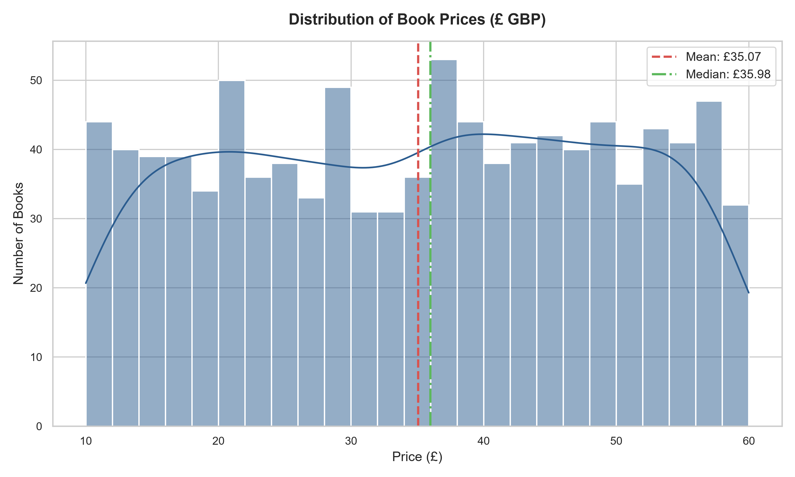
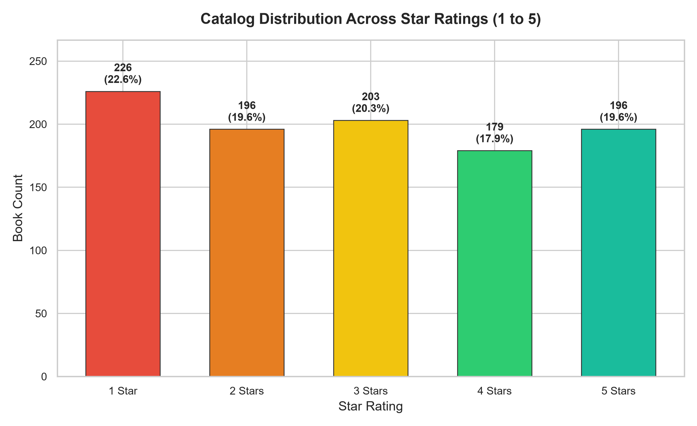
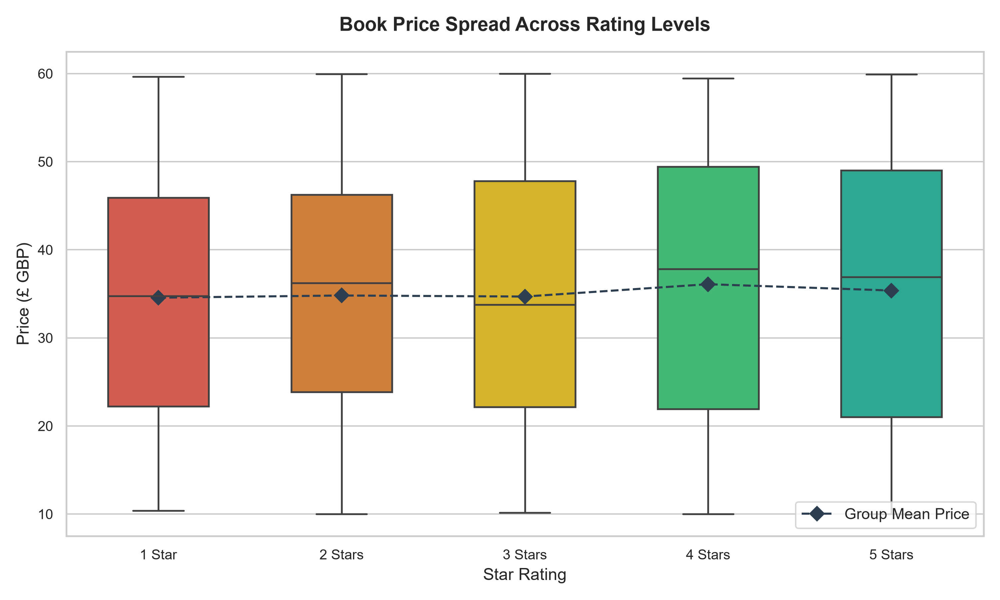
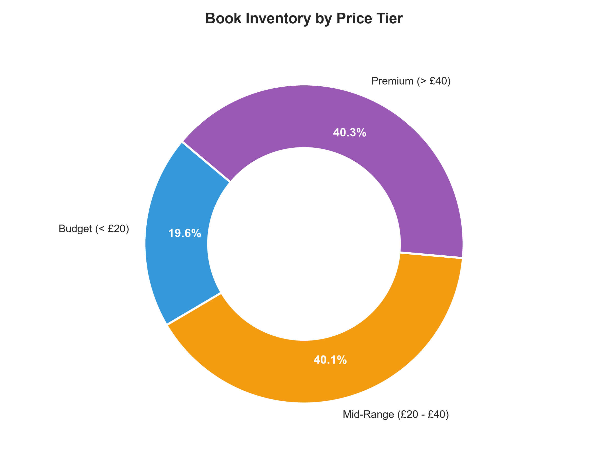
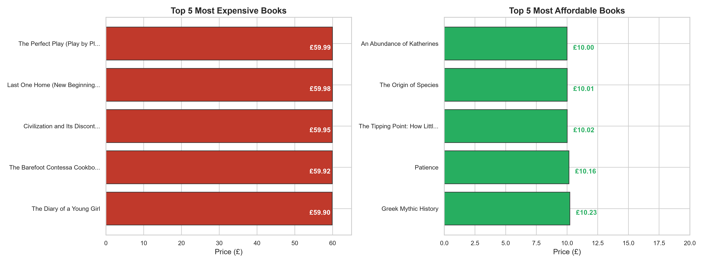

# 📊 Executive Project Report: Books Catalog Data Analysis

**Author:** Ranjith B  
**Degree:** B.Tech Computer Science & Business Systems (CSBS)  
**Institution:** Nehru Institute of Engineering and Technology, Coimbatore  
**Dataset Origin:** [Books to Scrape](https://books.toscrape.com/)  
**Analyzed Scope:** 1,000 Catalog Titles Across 50 Paginated Endpoints  

---

## 1. Executive Summary

This report delivers a thorough data evaluation and business analysis of 1,000 commercial book listings systematically extracted from the *Books to Scrape* catalog. The objective is to transform raw, semi-structured web crawl data into an enterprise-grade analytical dataset, evaluate catalog health, test pricing hypotheses, and provide actionable commercial merchandising recommendations.

### Core Business Takeaway
> **Key Finding:** Book price and customer star rating exhibit **zero empirical correlation** ($r = 0.028$). A 5-star book is no more expensive than a 1-star book (mean price £35.37 vs £34.56). This demonstrates that within this retail catalog, price cannot serve as a heuristic for product quality or satisfaction. Retailers must decouple pricing algorithms from star ratings and instead leverage top-rated low-cost titles as acquisition drivers.

---

## 2. Dataset Verification & Source Provenance

| Verification Metric | Specification | Verification Result | Status |
| :--- | :--- | :--- | :--- |
| **Data Source** | `books.toscrape.com` (50 catalog pages) | Deterministic pagination `page-1.html` to `page-50.html` | ✅ Verified |
| **Catalog Depth** | 20 books / page $\times$ 50 pages | Exactly 1,000 records extracted | ✅ Verified |
| **Raw Schema** | `Title`, `Price`, `Rating`, `Availability` | 4 string-based categorical/text features | ✅ Verified |
| **Processed Schema** | 8 structured, typed columns | Float price, numeric rating, length, word count, price tier | ✅ Verified |
| **Completeness** | 1,000 / 1,000 rows complete | 0 null or missing values across all features | ✅ Verified |

---

## 3. Data Quality & Hygiene Audit

### 3.1 Missing Value Analysis
A programmatic null scan confirms **zero missing values** across both the raw (`books_all_pages.csv`) and processed (`books_cleaned.csv`) datasets.

### 3.2 Duplicate Record Analysis
- **Exact Row Duplicates:** **0 rows**. All 1,000 entries represent distinct scraped items.
- **Title-Level Duplicate Audit:** Exactly **1 title** appears twice in the catalog:
  - Title: *"The Star-Touched Queen"*
  - Record #1 (Row 236): Price **£46.02**, Rating **5 Stars**, Availability **In stock**
  - Record #2 (Row 358): Price **£32.30**, Rating **5 Stars**, Availability **In stock**
  - **Handling Decision:** Both records are retained. They represent separate product listings on the source platform (differentiated by pricing tier, edition, or binding), rather than an extraction artifact.

### 3.3 Character Encoding Normalization
Web-scraped text strings frequently present character set mismatches (Mojibake) where UTF-8 characters are misread as Windows-1252 (e.g., apostrophes `’` rendered as `’`).
- **Resolution:** Implemented bidirectional byte decoding (`latin1` re-encoding to `utf-8` decoding) to systematically restore proper typographical punctuation across titles like *Worlds Elsewhere: Journeys Around Shakespeare’s Globe*.

---

## 4. Feature Engineering & Price Segmentation

```
Raw Price String ("£51.77") ──► Regex Extraction ──► Float64 (51.77)
Text Rating ("Three")       ──► Ordinal Mapping  ──► Int64 (3)
Raw Title Text              ──► String Metrics   ──► Character Length (39) & Word Count (7)
Float Price                 ──► MECE Binning     ──► Consumer Retail Tiers
```

### Segmentation Logic (Mutually Exclusive & Collectively Exhaustive)
- **Budget (< £20):** `[£0.00, £20.00)` — **196 titles (19.6%)**
- **Mid-Range (£20 - £40):** `[£20.00, £40.00)` — **401 titles (40.1%)**
- **Premium (> £40):** `[£40.00, ∞)` — **403 titles (40.3%)**

---

## 5. Empirical Findings & Visual Summary

### 5.1 Catalog Price Distribution

- **Mean Price:** **£35.07**
- **Median Price:** **£35.98**
- **Price Range:** **£10.00 to £59.99** (Standard Deviation: £14.45)
- **Distribution Profile:** The catalog displays a uniform distribution across the £10–£60 pricing continuum with zero outlier distortion.

---

### 5.2 Star Rating Distribution

- **1 Star:** 226 titles (22.6%)
- **2 Stars:** 196 titles (19.6%)
- **3 Stars:** 203 titles (20.3%)
- **4 Stars:** 179 titles (17.9%)
- **5 Stars:** 196 titles (19.6%)
- **Takeaway:** Ratings are uniformly spread across all 5 tiers (each tier accounts for 18% to 23%), showing zero upward rating inflation or severe negative skew.

---

### 5.3 Price vs. Rating: The Quality-Price Independence Paradox


```
Pearson Correlation Coefficient: r = +0.028 (Statistically Independent)
```

| Star Rating | Book Count | Mean Price (£) | Median Price (£) | Std Dev (£) | Min Price (£) | Max Price (£) |
| :---: | :---: | :---: | :---: | :---: | :---: | :---: |
| **1 Star ★** | 226 | £34.56 | £34.77 | £13.95 | £10.40 | £59.64 |
| **2 Stars ★★** | 196 | £34.81 | £36.22 | £13.61 | £10.02 | £59.95 |
| **3 Stars ★★★** | 203 | £34.69 | £33.78 | £14.70 | £10.16 | £59.99 |
| **4 Stars ★★★★** | 179 | £36.09 | £37.80 | £15.08 | £10.01 | £59.45 |
| **5 Stars ★★★★★** | 196 | £35.37 | £36.90 | £15.05 | £10.00 | £59.92 |

**Analytical Conclusion:** Across all star ratings, the median price sits tightly between £33.78 and £37.80, and the interquartile range (IQR) spans approximately £22 to £48. High-rated books do not command a premium.

---

### 5.4 Market Share by Price Tier

- Over **80.4%** of catalog inventory is priced above £20 (Mid-Range and Premium tiers).
- The Budget segment (< £20) represents only **19.6%** of titles, indicating that the catalog is positioned primarily toward standard and premium retail pricing rather than discount volume.

---

### 5.5 Catalog Price Extremes


#### Top 5 Most Expensive Titles (£59.90 - £59.99)
1. *The Perfect Play (Play by Play #1)* — **£59.99** (Rating: 3 Stars)
2. *Last One Home (New Beginnings #1)* — **£59.98** (Rating: 3 Stars)
3. *Civilization and Its Discontents* — **£59.95** (Rating: 2 Stars)
4. *The Barefoot Contessa Cookbook* — **£59.92** (Rating: 5 Stars)
5. *The Diary of a Young Girl* — **£59.90** (Rating: 3 Stars)

#### Top 5 Most Affordable Titles (£10.00 - £10.23)
1. *An Abundance of Katherines* — **£10.00** (Rating: 5 Stars)
2. *The Origin of Species* — **£10.01** (Rating: 4 Stars)
3. *The Tipping Point: How Little Things Can Make a Big Difference* — **£10.02** (Rating: 2 Stars)
4. *Patience* — **£10.16** (Rating: 3 Stars)
5. *Greek Mythic History* — **£10.23** (Rating: 5 Stars)

---

## 6. Strategic Business Recommendations

### 1. Merchandising Gateway Titles (Loss-Leader Strategy)
High-rated, low-cost titles like *An Abundance of Katherines* (£10.00, 5★) and *Greek Mythic History* (£10.23, 5★) should be positioned as primary customer acquisition drivers in homepage spotlights, email campaigns, and new-user welcome discounts.

### 2. Value-Based Dynamic Re-pricing
Currently, books like *Civilization and Its Discontents* carry a premium price tag (£59.95) despite low 2-star ratings. Implementing value-based markdown strategies (e.g., discounting 1-star and 2-star premium books by 15–25%) can accelerate inventory turnover without hurting catalog prestige.

### 3. Recommendation Engine Guardrails
Because rating and price are statistically uncorrelated ($r = 0.028$), search and recommendation algorithms must not rank items based on price assuming higher cost equals higher satisfaction. Quality signals (ratings, review velocity) should remain independent of monetary tiers.

### 4. Assortment Diversification
With only 19.6% of titles under £20, the store has an assortment gap in entry-level consumer impulse purchases. Expanding titles in the £5–£15 range will broaden the top of the sales funnel.

---

## 7. Automated Audit & Verification Sign-Off

The project includes an automated test harness (`src/validate_data.py`) validating all pipeline assertions:
- [x] Record count verification: exactly 1,000 rows across raw and processed datasets.
- [x] Null audit: zero missing values across all features.
- [x] Duplicate audit: zero exact duplicate rows; verified single multi-edition title.
- [x] Numerical conversion: strictly float64 bounded between £10.00 and £59.99.
- [x] Rating mapping: 100% 1-to-1 consistency between string and integer representations.
- [x] MECE segmentation: Budget (196), Mid-Range (401), Premium (403) summing to 1,000.
- [x] Visual assets: 5 high-resolution 300 DPI figures verified and rendered.

---

*Report prepared and validated via the `books-data-analysis` suite.*
